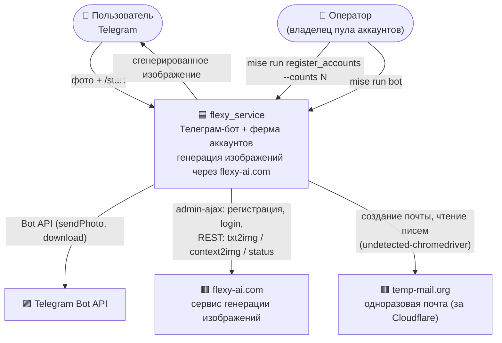
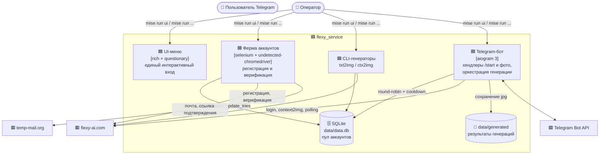
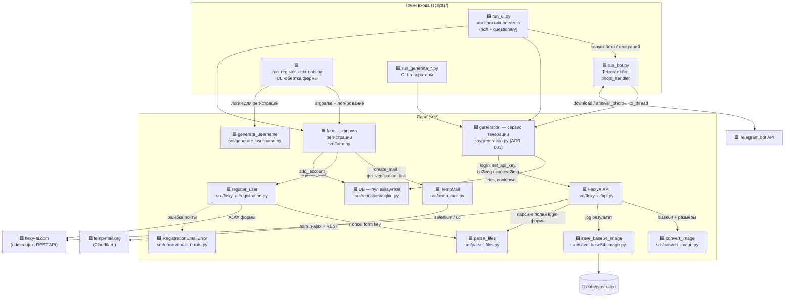

# Архитектура flexy_service (C4 Model)

Описание системы по методологии [C4 Model](https://c4model.com/): L1 — контекст системы, L2 — контейнеры, L3 — компоненты.

Диаграммы нарисованы в mermaid (flowchart-нотация в стиле C4 для совместимости с GitHub).

---

## L1 — Контекст системы (System Context)

Кто и как взаимодействует с системой целиком.

| Актор / система | Роль |
|---|---|
| Пользователь Telegram | Отправляет фото, получает результат генерации |
| Оператор | Запускает бота и ферму регистрации аккаунтов через `mise` |
| Telegram Bot API | Доставка сообщений и фото |
| flexy-ai.com | Внешний сервис генерации (WordPress + плагин ARMember) |
| temp-mail.org | Одноразовые почтовые ящики для регистрации |

---

## L2 — Контейнеры (Containers)

Из чего состоит система и как контейнеры общаются между собой.

| Контейнер | Технологии | Ответственность |
|---|---|---|
| UI-меню (`scripts/run_ui.py`) | rich, questionary | Единый интерактивный вход: меню запуска бота, генераций, регистрации |
| Telegram-бот (`scripts/run_bot.py`) | aiogram 3, asyncio | Приём фото, запуск генерации в потоках, отправка результатов |
| Ферма аккаунтов (`src/farm.py`) | selenium, undetected-chromedriver | Регистрация аккаунтов и сохранение в пул (вызывается из CLI и UI) |
| CLI-генераторы (`scripts/run_generate_*.py`) | requests | Разовые генерации без бота |
| Пул аккаунтов (`src/repository/sqlite.py`) | SQLite | Хранение аккаунтов, ротация, cooldown, лимиты |

---

## L3 — Компоненты (Components)

Разбиение контейнеров на компоненты: кто за что отвечает и кто кого вызывает.

### Компоненты

| Компонент | Модуль | Ответственность | Используют |
|---|---|---|---|
| **run_ui.py** | `scripts/run_ui.py` | Единое интерактивное меню (ADR-002): запуск бота, генераций, регистрации; валидация ввода, панели и спиннеры rich | generation, farm, run_bot |
| **run_bot.py** | `scripts/run_bot.py` | Хендлеры aiogram (`/start`, фото): скачивание фото под uuid-именем, запуск генерации через сервис в `asyncio.to_thread`, отправка результата | generation |
| **run_register_accounts.py** | `scripts/run_register_accounts.py` | CLI-обёртка фермы: argparse + логирование, вызов `farm.register_accounts(count)` | farm |
| **run_generate_*.py** | `scripts/` | CLI-генерации txt2img / context2img без бота — тонкая обёртка над сервисом | generation |
| **generation** | `src/generation.py` | Сервис генерации (ADR-001): перебор свободных аккаунтов пула, login, генерация; при rate-limit аккаунт уходит в cooldown, запрос идёт дальше. Единственная реализация сценария для бота и CLI | DB, FlexyAiAPI |
| **farm** | `src/farm.py` | Ферма регистрации (ADR-001 фаза 2): подбор браузера и uc-драйвера (`setup_driver`), цикл «почта → регистрация → верификация → пул» | TempMail, register_user, DB, generate_username |
| **FlexyAiAPI** | `src/flexy_ai/api.py` | HTTP-клиент flexy-ai.com на `requests.Session`: парсинг login-формы, логин, получение токена, `txt2img` / `context2img`, поллинг статуса задачи | parse_files, convert_image, save_base64_image |
| **register_user** | `src/flexy_ai/registration.py` | Регистрация через `admin-ajax`: получение nonce и form_key, проверка полей, отправка формы. Ошибки почты → `RegistrationEmailError` | parse_files, RegistrationEmailError |
| **TempMail** | `src/temp_mail.py` | Selenium-клиент temp-mail.org: `create_mail()` (ожидание сгенерированного адреса), `get_verification_link()` (поиск письма и ссылки подтверждения) | webdriver/uc |
| **DB** | `src/repository/sqlite.py` | Пул аккаунтов в SQLite. Потокобезопасен (соединение на вызов). `get_account()` — атомарный захват наименее недавно использованного свободного аккаунта; `set_account_busy()` — cooldown; `update_account_tries()` — списание генераций. Автомиграция схемы | — |
| **parse_files** | `src/parse_files.py` | BeautifulSoup-парсинг скрытых полей форм ARMember: `arm_wp_nonce`, `arm_nonce_check`, безымянное числовое поле | — |
| **convert_image** | `src/convert_image.py` | PIL: нормализация режима цветов, ресайз под требования API (512–1536, кратность 8), JPEG, base64 | — |
| **save_base64_image** | `src/save_base64_image.py` | Декодирование base64 → jpg в `data/generated/` (уникальное имя на параллельные генерации) | — |
| **generate_username** | `src/generate_username.py` | Случайные логины (буквы + цифры) | — |
| **RegistrationEmailError** | `src/errors/email_errors.py` | Доменное исключение: невалидная почта при регистрации | — |

### Ключевые сценарии

**Генерация (пользователь → картинка):**

1. `photo_handler` скачивает фото под uuid-именем и сразу отвечает пользователю
2. `asyncio.to_thread(generation.context_to_image)` — генерация не блокирует бота
3. `DB.get_account()` атомарно берёт свободный аккаунт (round-robin по `last_used`)
4. `FlexyAiAPI.login()` → `set_api_key()` → `context_to_image()` (поллинг статуса ~30 сек)
5. Ошибка API → `set_account_busy(120с)` → автоматический переход на следующий аккаунт
6. Успех → `update_account_tries()` → `answer_photo` с результатом

Шаги 3–6 выполняет `src/generation.py` — тот же код используется CLI-генераторами.

**Регистрация аккаунта (ферма):**

1. `setup_driver()` — uc подбирает согласованные браузер + драйвер
2. `TempMail.create_mail()` — одноразовая почта на temp-mail.org
3. `register_user()` — AJAX-регистрация с nonce/form_key
4. `TempMail.get_verification_link()` → `FlexyAiAPI.verification_and_login()` → токен
5. `DB.add_account(api_key, email, password)` — аккаунт в пуле с `tries=3`
